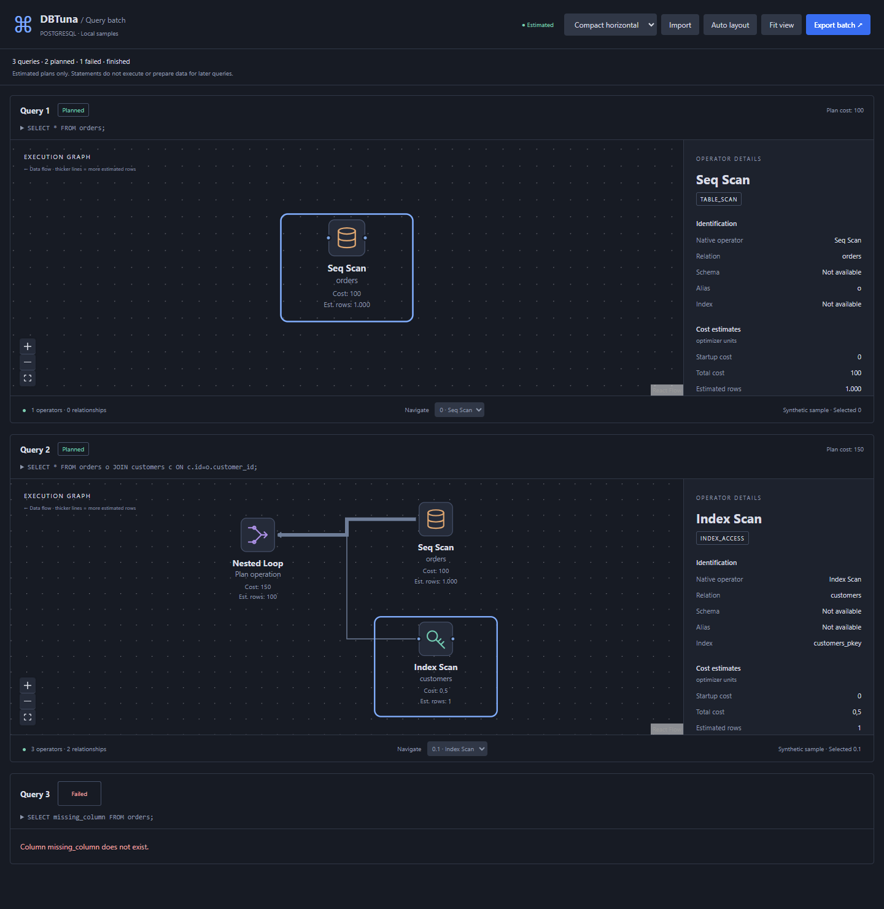
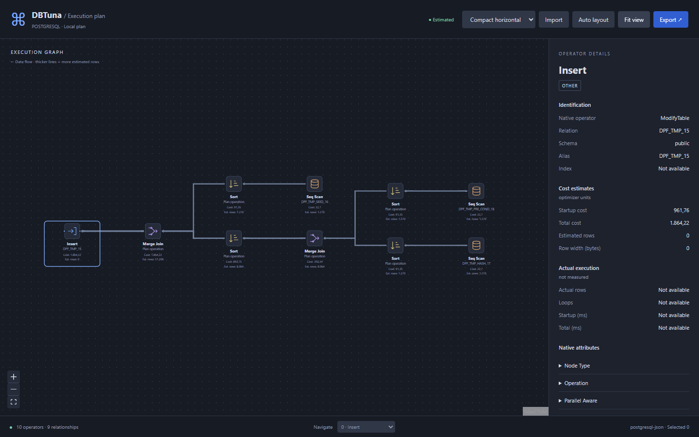

# DBTuna

Explore PostgreSQL execution plans inside VS Code, beside your SQL editor. DBTuna provides a React Flow graph with ELK layout, operator details, estimated costs and cardinalities, raw attributes, pan/zoom, fit view, minimap, operator navigation and offline JSON import/export. No backend is required.


## Install

In VS Code, run **Extensions: Install from VSIX…** and select `dbtuna-0.3.0.vsix`. Then run **DBTuna: Load Sample Plan** for an offline demonstration.

## Explain a query

1. Open a trusted workspace and a `.sql` file.
2. Run **DBTuna: Add Connection**. Enter host, port, database, username, TLS preference and password. Passwords use VS Code SecretStorage.
3. Run **DBTuna: Manage Connections** and choose **Test Connection**.
4. Select one or more complete SQL statements, separated by semicolons. With no selection, DBTuna uses the entire file. Each statement must be SELECT, VALUES, INSERT, or WITH ending in SELECT or INSERT.
5. Run **DBTuna: Explain Query** from the Command Palette or SQL editor context menu. Select a connection if prompted.
6. Hover over an operator for half a second to see startup cost, total cost, estimated rows and row width. Move away to dismiss the tooltip. Click graph operators to inspect details. Use Auto layout, Fit view, zoom controls or the navigation dropdown.

You can also use the graph button in the top-right of a SQL editor. Explain Query is always available in the Command Palette, including for text files and PostgreSQL language modes; click the editor before invoking it. Selected log text is not stripped automatically.

Use **Select Connection** to switch profiles. **Manage Connections** supports testing, updating and removal. INSERT … SELECT, INSERT … VALUES, RETURNING and ON CONFLICT are supported as estimated plans. UPDATE, DELETE and data-modifying CTEs remain unsupported. Live EXPLAIN is always estimated and never uses ANALYZE. Use a least-privilege database role: planning can invoke functions.

## Explain multiple queries

Use the same **DBTuna: Explain Query** command with several statements selected, or a SQL file containing several statements and no selection. DBTuna validates each statement, then requests estimated plans sequentially using the chosen connection.

Each numbered query section has its own expandable SQL preview, status, estimated plan cost, graph, operator navigation and details. A failed or unsupported query gets an error in its own section; other plans remain visible. Use **Cancel batch** or the notification cancellation control to stop remaining work while keeping finished plans. Global Fit view, Auto layout and Plan view controls apply to mounted graphs. Off-screen graphs initialize as you scroll.

**These statements are explained, never executed.** Earlier INSERTs do not populate data for later queries; CREATE/TEMP setup and unsupported statement types are not run. Each plan uses a separate read-only transaction/connection, not a shared batch snapshot. Limits: 20 statements, 1 MiB selected SQL, 5,000 combined operators and 5 MiB exported batch data. Ambiguous or unfinished quoting stops the batch before any database request. Semicolons in strings, quoted identifiers, dollar quotes and comments are handled without blind splitting.



## Visualization views

Use the **Plan view** selector in the header. **Compact horizontal** is the default: the result operation is on the left, inputs branch to the right, and arrows point left to show data flow. Operator icons have labels, relation names, cumulative estimated costs and estimated rows underneath. Line widths scale logarithmically with child row estimates (1–5 units within the current plan); missing estimates use a thin line. Costs remain PostgreSQL optimizer units, not elapsed time or per-operator percentages.

Choose **Cards · top down** to return to the original view. Switching views preserves the selected operator and saves the view preference in webview state. Both views support pan/zoom, fit, auto layout, selection, details and the half-second cost tooltip.



## Import and export

**Export batch** saves all results, SQL previews, statuses and errors in a DBTuna batch envelope; **Import Execution Plan** restores it without connecting or resuming work. One successful query still exports the canonical single-plan format.

**Import Execution Plan** also accepts raw PostgreSQL JSON (`[{"Plan": …}]`), JSON-encoded output, and DBTuna canonical 1.0 JSON. Import requires no connection. **Export Execution Plan** saves the canonical graph, query text when present, metadata and unknown native properties. Synthetic samples are explicitly labeled. Imported actual execution statistics are shown separately from estimates.

## Develop

Use Node.js 22 or later and npm:

```sh
npm install
npm run typecheck
npm run lint
npm test
npm run build
npm run test:vscode
npm run package
```

Press F5 to launch the configured Extension Development Host. pnpm is also supported (`pnpm install`, then `pnpm run …`). Package code is bundled; the installed extension does not require node_modules.

For a real isolated database integration test, run `node test/integration/embedded.mjs`. This uses the development-only embedded-postgres binary package, a localhost-only test server on port 55439 and test credentials. Alternatively, provide your own disposable test PostgreSQL server with the test credentials in `test/integration/postgres.test.ts` and run `npm run test:postgres`. Never point these tests at production.

## Limits and verification

PostgreSQL 18.4 was verified with live SELECT, join and six INSERT plan forms (including the generator lookup), unchanged target row counts, invalid SQL and read-only enforcement. PostgreSQL 14+ is targeted; older supported versions have not been tested here. The AST parser supports common PostgreSQL syntax and rejects unsupported constructs, including some valid native syntax. Dollar-quoted expressions and INSERT DEFAULT VALUES may be rejected by the AST parser.

Import limits: 5 MiB, depth 64, 1,000 operators. Graphs must form a rooted forest. TLS uses Node's certificate trust store; custom certificate pickers are not included. No actual execution, results grid, history, comparison, or automatic tuning is implemented. Optional heuristic diagnostics are deferred.

See `docs/verification.md` for exact test results and remaining verification gaps, and `docs/security.md` for planning and credential handling.
