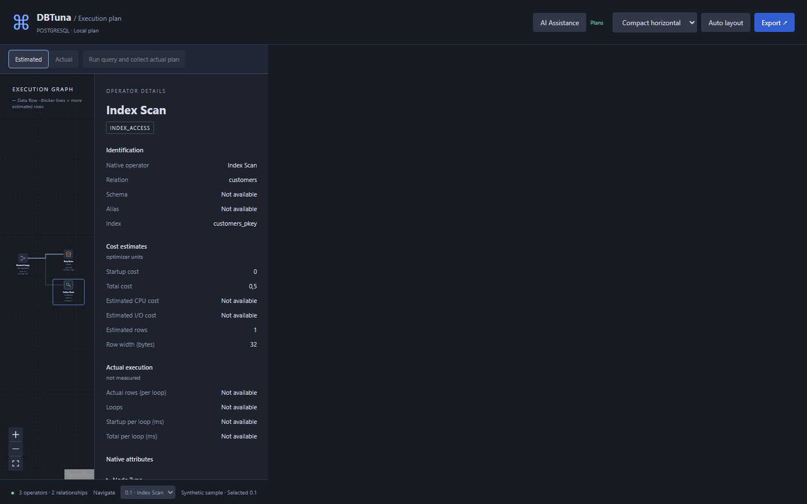

# DBTuna

Explore PostgreSQL and SQL Server execution plans beside your SQL in VS Code.

Inspect estimated plans, collect actual plans after confirmation, and get optional AI optimization advice for the selected operator.

[Get a release](https://github.com/YoeriBoerema/DBTuna/releases/latest) · [Quick start](docs/getting-started.md) · [Documentation](docs/README.md) · [Development](docs/development.md) · [Changes](CHANGELOG.md)



## What you can do

| Feature | Behavior |
| --- | --- |
| Estimated plans | Explain selected SQL, or the whole file when nothing is selected. |
| Multiple queries | Inspect each returned statement in its own numbered section, with independent selection and errors. |
| Actual plans | Run an eligible SELECT or INSERT after confirmation, then switch between Estimated and Actual. |
| Operator details | Inspect rows, costs, timings and native attributes. Cost tooltips appear after 0.5 seconds. |
| Two graph views | Choose compact horizontal or top-down cards, with pan, zoom and operator navigation. |
| Offline inspection | Import PostgreSQL JSON, SQL Server Showplan XML or DBTuna JSON through the Command Palette. |
| AI assistance | Supply an OpenAI API key and model, then explicitly request a score, short suggestions and proposed SQL. |

**Explain Query collects estimates. Run query executes SQL. Successful INSERT runs commit changes.** See [actual execution](docs/getting-started.md#collect-an-actual-plan) before running writes.

## Install and try it

1. Download the `.vsix` asset from [GitHub Releases](https://github.com/YoeriBoerema/DBTuna/releases/latest).
2. In VS Code, open the Command Palette and run **Extensions: Install from VSIX...**.
3. Run **DBTuna: Load Sample Plan** to explore without a database connection.
4. For live plans, open a trusted workspace and run **DBTuna: Add Connection**.
5. Select SQL in an editor, then run **DBTuna: Explain Query** from the Command Palette or editor context menu.

The source version is in [generated build information](docs/build-info.md); the latest published release is **v0.6.14**. See [development and packaging](docs/development.md). VS Code 1.96 or later is required.

## Database support

| | PostgreSQL | SQL Server |
| --- | --- | --- |
| Estimated plan format | EXPLAIN JSON | SHOWPLAN_XML |
| Actual plan collection | EXPLAIN ANALYZE with buffers | STATISTICS XML |
| Query grouping | Semicolon-delimited statements | GO-delimited batches, displayed as individual statement plans |
| Authentication | Username/password | SQL authentication or explicit NTLM credentials |
| Verification | Live PostgreSQL 18.4 integration | Fixtures, session-protocol tests and browser checks; live integration remains opt-in |

Common SELECT and INSERT forms are supported. Supported syntax differs by engine; UPDATE, DELETE, DDL and dynamic execution are outside the current scope. Read the [PostgreSQL](docs/postgres-support.md) and [SQL Server](docs/sqlserver-support.md) guides for exact boundaries.

## Privacy and execution

Database passwords and the OpenAI API key stay in VS Code SecretStorage. Database operations run in the extension host; no standalone backend is required. Imported plans need no connection.

AI assistance is optional. Clicking **Get AI advice** sends the displayed query, normalized plan, operator and context to OpenAI. SQL literals and object names are included; credentials and connection labels are excluded. Advice never executes SQL. Details: [AI assistance](docs/ai-assistance.md) and [security](docs/security.md).

## Documentation

- [Getting started](docs/getting-started.md): connections, query selection, actual execution, import/export and commands.
- [Troubleshooting](docs/troubleshooting.md): missing commands, disabled Run actions, parsing and connection problems.
- [Architecture](docs/architecture.md): canonical plans, connectors, host services and UI state.
- [Adding a connector](docs/adapter-development.md): extend database support without changing the graph renderer.
- [Verification](docs/verification.md): reproducible checks and known testing gaps.

## Develop

```sh
npm install
npx playwright install chromium
npm run verify
npm run package
```

Development requires Node.js 22 or later. `npm run verify` runs type checks, lint, unit tests, both builds and all browser suites. Additional integration checks, screenshot generation and packaging instructions are in the [development guide](docs/development.md).

Licensed under [MIT](LICENSE).
